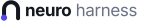

<p align="center">
  <picture>
    <source media="(prefers-color-scheme: dark)" srcset="assets/neuro-harness-lockup-dark.svg">
    
  </picture>
</p>

<p align="center"><b>Seu estúdio de agentes de IA para pós-produção de vídeo, em português.</b><br>
Especialistas de IA em pt-BR para edição de vídeo, gestão de tráfego e copy, com painel, app para macOS (Apple Silicon) e Windows e plugins para o Claude Code.<br>
<a href="https://harness.neuros.my">harness.neuros.my</a></p>

---

O Neuro Harness reúne, num só lugar:
- **um agente que edita vídeo:** cortes, legendas, cenas, som, master e entrega, com o Remotion Studio para acompanhar;
- **vários modelos de IA à escolha:** Kimi, DeepSeek, OpenRouter, Gemini, OpenAI, MiniMax, GLM, OpenCode, NVIDIA, Meta, ChatGPT/Codex por login;
- **um painel web local** e **um app nativo**.

Ele **não é um fork** do DeepSeek Harness. Os pacotes do Harness ficam intactos, numa versão fixa, e o Neuro Harness acrescenta por cima o que é dele.

**Sumário:** [Começar](#começar) · [App desktop](#app-desktop) · [Comandos](#comandos) · [O que vem junto](#o-que-vem-junto) · [Guias](#guias) · [Versões](#versões) · [Créditos](#créditos) · [Autor](#autor)

## Começar

**Um comando instala tudo:** dependências, login no GitHub, Neuro Harness, plugins e app.

**macOS e Linux:**

```bash
curl -fsSL https://harness.neuros.my/install.sh | bash
```

**Windows 10/11 (PowerShell):**

```powershell
irm https://harness.neuros.my/install.ps1 | iex
```

Se o site estiver fora do ar, troque `https://harness.neuros.my/` por `https://raw.githubusercontent.com/monrars1995/neuro-harness-install/main/` nos comandos acima.

**O que o instalador faz:**
1. Instala o que faltar entre Node.js 22+, git, Python 3.10+, FFmpeg e GitHub CLI (Homebrew no macOS, apt/dnf/pacman no Linux, winget no Windows).
2. Faz o login no GitHub pelo navegador. Os repositórios são privados, então a conta precisa ter acesso.
3. Baixa a última versão do Neuro Harness e põe o comando `neuro-harness` no seu PATH.
4. Roda o `neuro-harness setup`.
5. Importa as chaves de API que você já tem no Hermes e no OpenCode.
6. Instala o app desktop e abre o painel.

O instalador fica no repositório público [neuro-harness-install](https://github.com/monrars1995/neuro-harness-install), que só tem os scripts, sem segredos. Lá estão também as opções (`--sem-app`, `--versao`…).

**Para desenvolver, a partir de um clone:**

```bash
git clone https://github.com/monrars1995/oneuros-harness.git && cd oneuros-harness
node lib/cli.js setup --link   # --link: plugins da distribuição ligados direto do clone
node lib/cli.js open
```

## App desktop

| Sistema | Arquivo |
|---|---|
| macOS, Apple Silicon (M1 em diante) | `Neuro-Harness-<versão>-arm64.dmg` |
| Windows 10/11, 64 bits | `Neuro-Harness-Setup-<versão>.exe` |

Baixe em [harness.neuros.my/download](https://harness.neuros.my/download) ou na página de [Releases](https://github.com/monrars1995/oneuros-harness/releases). Os instaladores são gerados pelo CI a cada tag.

**O que o app faz ao abrir:**
1. confere as dependências. Se faltar alguma, o botão **Instalar o que falta** abre o Terminal (ou o PowerShell) com o instalador, e o app continua sozinho quando ele terminar;
2. instala ou atualiza a distribuição;
3. sobe o Harness local;
4. abre o painel numa janela nativa.

Ao sair, ele para o Harness que subiu.

**Avisos:**
- **Sem assinatura de código:** os apps ainda não são assinados. Veja em [docs/app-desktop.md](docs/app-desktop.md) como abrir no macOS (Gatekeeper) e no Windows (SmartScreen).

## Comandos

| Comando | O que faz |
|---|---|
| `neuro-harness setup [--link]` | Instala ou atualiza tudo, sem refazer o que já está certo. O `--link` liga os plugins direto deste clone, para desenvolvimento |
| `neuro-harness start` · `stop` · `restart` | Sobe ou para o Harness em segundo plano. O log fica em `~/.neuro-harness/harness.log` |
| `neuro-harness status` · `url` · `open` | Mostra o estado, o endereço local (com o token de acesso) ou abre no navegador |
| `neuro-harness doctor` | Confere as ferramentas, o Harness, o motor, o perfil, os plugins, as chaves no cofre e o cache npm |
| `neuro-harness deps` | Confere os pré-requisitos do sistema e mostra o comando do instalador se faltar algo |
| `neuro-harness engine [versão]` | Instala ou troca o motor neuro-mv-edit usado pelas sessões |
| `neuro-harness credenciais [--dry-run] [--sobrescrever]` | Importa chaves de API do Hermes e do OpenCode para o cofre do Harness. Testa cada uma e nunca mostra os valores |
| `neuro-harness run "<tarefa>" [--modelo provedor/modelo]` | Uma tarefa sem interface, com o mesmo ambiente das sessões |
| `neuro-harness entrar [--chave nh_…]` | Liga o computador à sua conta Neuro: instala e atualiza sem GitHub |
| `neuro-harness conta` · `sair` | Mostra a conta conectada · apaga a chave deste computador |
| `neuro-harness claude [instalar\|status\|remover] [--dry-run]` | Leva os especialistas para o Claude Code: marketplace local `neuro-harness` com os plugins `neuro-harness`, `neuro-mv-edit` e `neuro-ads-manager`, nas versões fixadas, sem GitHub. Veja [docs/claude-code.md](docs/claude-code.md) |
| `neuro-harness version` | Versão da distribuição |

**Variáveis de ambiente:**

| Variável | Padrão | Para quê |
|---|---|---|
| `NEURO_HARNESS_HOME` | `~/.neuro-harness` | Pasta da distribuição |
| `NEURO_HARNESS_PROFILE` | `neuro` | Perfil do Harness |
| `NEURO_HARNESS_PORT` | `3082` | Porta do painel; se estiver ocupada, usa uma livre |
| `NEURO_WORKDIR` | `~/Neuro` | Pasta de trabalho das sessões |
| `NEURO_HOME` | `~/.neuro-mv-edit` | Biblioteca e memória do neuro-mv-edit |

## Claude Code

Os mesmos especialistas também rodam no Claude Code, como plugins:

```bash
curl -fsSL https://harness.neuros.my/install.sh | bash -s -- --apenas-claude-code   # só o Claude Code
curl -fsSL https://harness.neuros.my/install.sh | bash -s -- --claude-code          # Harness completo + Claude Code
neuro-harness claude instalar                                                       # quem já tem o Harness
```

Também pelo npm: `npx @oneuros/harness claude`. Detalhes em [docs/claude-code.md](docs/claude-code.md).

## O que vem junto

| Peça | O que é |
|---|---|
| DeepSeek Harness 0.2.1-alpha.2 | O Harness, intacto e numa versão fixa, em `~/.neuro-harness/runtime` |
| **neuro-mv-edit 1.8.0** | Edição de vídeo, como plugin: skill, comando `neuro-mv-edit` nas sessões, Remotion e HyperFrames |
| **neuro-ads-manager 0.1.0** | Gestão de tráfego pago (Meta Ads), como plugin: auditoria, planejamento, relatórios, criativos e conversão |
| `neuro-harness-brand` | Identidade visual: isotipo "n-neurônio", nome, título e ícone da aba, nos temas claro e escuro |
| `neuro-harness-pt-br` | Português do Brasil em toda a interface (2.489 textos), como idioma padrão |
| App desktop | Electron 44 para macOS (Apple Silicon) e Windows (x64) |

**Plugins oficiais do DeepSeek Harness que já vêm ativos:**

| Plugin | O que faz |
|---|---|
| Agent Teams | Equipes de agentes, com roster, mensagens entre eles e quadro de tarefas compartilhado |
| Auto review | O modo de permissão **Auto**: um modelo revisa cada ação e só pede a sua aprovação quando há risco. Escolha no seletor de permissão ou com `/permission auto` |
| Busca em sessões | Os agentes buscam e leem sessões anteriores do espaço de trabalho |
| Terminal persistente | Processos de shell continuam vivos entre chamadas, como o Remotion Studio e servidores |
| Títulos de sessão | O título da sessão se atualiza a cada pedido |

**O ambiente das sessões é limpo:**
- o PATH começa por `~/.neuro-harness/bin`, sem pastas do Claude Code;
- o cache npm é próprio;
- nenhuma chave de provedor vem do ambiente: as chaves ficam no cofre do Harness.

## Guias

- [Instalação e operação](docs/instalacao.md)
- [Provedores e chaves](docs/provedores.md)
- [App desktop](docs/app-desktop.md)
- [Idiomas e traduções](docs/idiomas.md)
- [Identidade visual](docs/marca.md)
- [Arquitetura](docs/arquitetura.md)

## Código aberto e acesso

O código do Neuro Harness e dos especialistas é aberto (MIT): [oneuros-harness](https://github.com/monrars1995/oneuros-harness), [oneuros-mv-edit](https://github.com/monrars1995/oneuros-mv-edit) e [oneuros-ads-manager](https://github.com/monrars1995/oneuros-ads-manager). A instalação dos agentes passa pela sua conta Neuro, com aprovação: o instalador abre o navegador para você confirmar o computador. O que é privado da conta (os perfis de edição dos seus clientes) só é entregue a ela. Dados de campanhas e análises nunca ficam em repositório: vivem só na sua máquina.

## Versões

O projeto segue o [Versionamento Semântico](https://semver.org/lang/pt-BR/), e o histórico está no [CHANGELOG.md](CHANGELOG.md).
- **Uma versão para tudo:** a CLI e o app desktop compartilham a mesma versão; o `npm run check` confere.
- **Cada versão** tem uma tag `vX.Y.Z` e uma Release com os instaladores.

## Créditos

O Neuro Harness é **construído sobre o [DeepSeek Harness](https://github.com/deepseek-ai/deepseek-harness)** (MIT, © DeepSeek).
- **Não é oficial:** não é um produto da DeepSeek nem é endossado por ela, e "DeepSeek Harness" é marca registrada da DeepSeek.
- **Bases do agente:** o [dsh-superagent-prototype](https://github.com/deepseek-ai/dsh-superagent-prototype) (MIT), o Cordis, o pi-ai, o Electron e o electron-builder.

A lista completa e as licenças estão em [NOTICE](NOTICE).

## Autor

**Ramon Ribeiro**:
- GitHub [@monrars1995](https://github.com/monrars1995)
- Instagram [@monrars](https://instagram.com/monrars) e [@goldneuron.io](https://instagram.com/goldneuron.io)

Licença [MIT](LICENSE).
