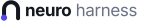

# Identidade visual

  <picture>
    <source media="(prefers-color-scheme: dark)" srcset="../assets/neuro-harness-lockup-dark.svg">
    
  </picture>

## Isotipo "n-neurônio"

O isotipo é um **n** minúsculo desenhado por **um traço único que nasce de um nó**. O nó é o corpo de um neurônio, no pé esquerdo; dele o axônio sobe e faz o arco da letra. O desenho é ao mesmo tempo:
- a letra inicial de *neuro*;
- um neurônio;
- o arreio (*harness*) que conduz o sinal.

**Isotipo e nome são uma coisa só:**
- o traço tem a mesma cor do texto (na interface, a cor do tema);
- o único acento é o nó;
- o nome é "**neuro** harness": "neuro" em negrito e "harness" em peso normal e cor suave.

## Cores

| Uso | Escuro | Claro |
|---|---|---|
| Traço e texto | `#ECEEF6` | `#15171F` |
| Nó (acento) | `#8F7DFF` | `#5A46F0` |
| "harness" e textos suaves | `#9AA0B4` | `#6B7186` |
| Fundo do ícone | `#121319` | `#F6F7FB` |

Na interface:
- o traço usa `currentColor`, para acompanhar o tema do Harness;
- o nó usa `light-dark()`;
- o ícone da aba usa `prefers-color-scheme`.

## Geometria

A grade é de 32×32:
- **Traço:** `M9 21.6V16a7 7 0 0 1 14 0v9`, com espessura 4 e pontas arredondadas.
- **Nó:** um círculo de centro (9, 24.4) e raio 3.1.
- **Recorte quadrado** centrado no desenho: `4.95 6.75 21 21`.

## Arquivos

São gerados por `npm run brand`, que chama `plugins/neuro-harness-brand/scripts/build-brand.py`:
- `assets/neuro-harness-mark-{dark,light}.svg`: o isotipo sozinho;
- `assets/neuro-harness-lockup-{dark,light}.svg`: o isotipo com o nome;
- `assets/neuro-harness-icon-{dark,light}.svg` e `neuro-harness-icon-1024.png`: o ícone de app;
- `assets/neuro-harness-favicon.svg`: o ícone da aba, que segue o tema do sistema.

O `lib/client.js` do plugin também é gerado: para mudar a marca, edite o script e rode de novo.

## Regras de marca do DeepSeek Harness

- **No nome:** "DeepSeek Harness" é marca registrada e não entra no nome do produto.
- **Na descrição:** é permitido, e pedido, dizer "construído sobre o DeepSeek Harness".
- **Materiais oficiais:** nada de logo da baleia nem de material oficial da DeepSeek. A marca oficial fica desligada no perfil (`ui-brand-official: disabled`), e o nosso plugin ocupa os mesmos espaços da interface (`sidebar.brand.mark`, `sidebar.brand.name`, `conversation.hero.brand.mark`).
